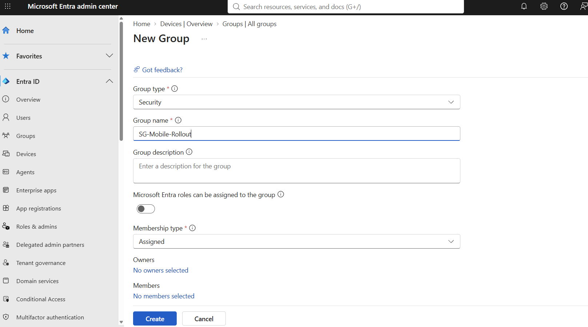
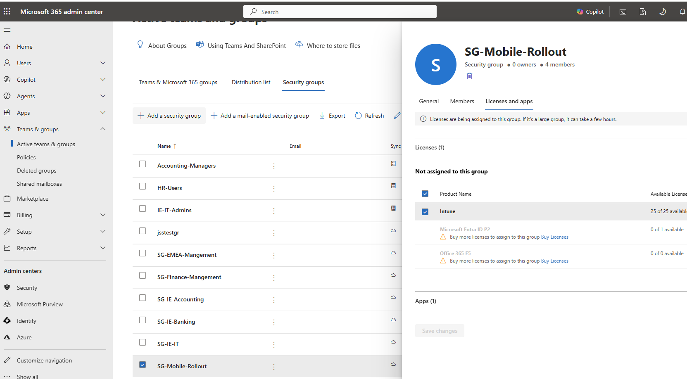
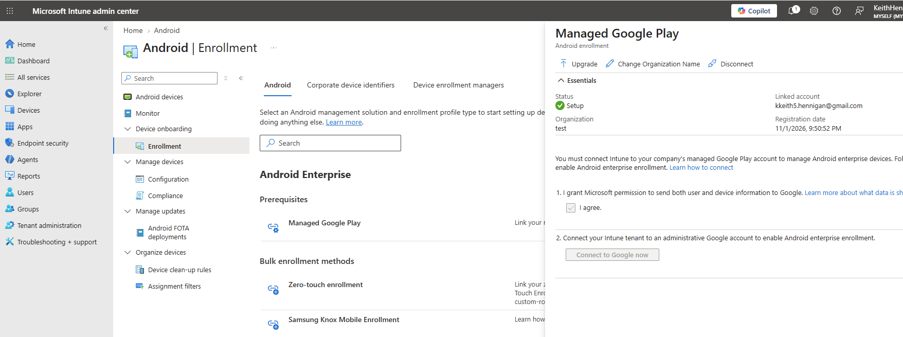
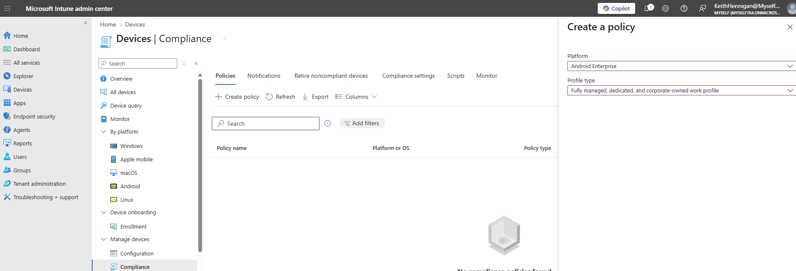
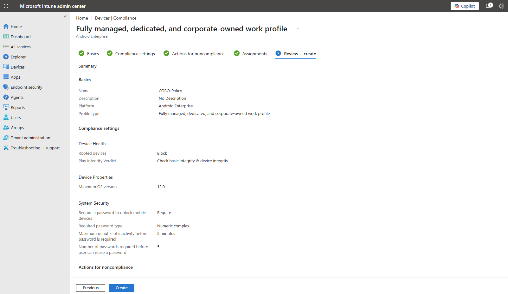
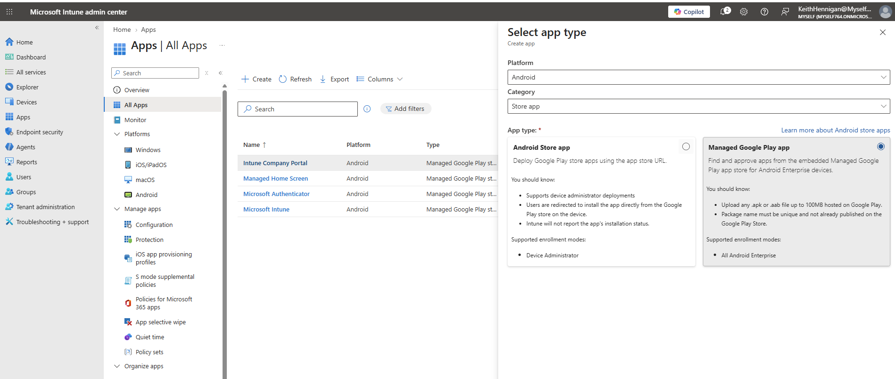
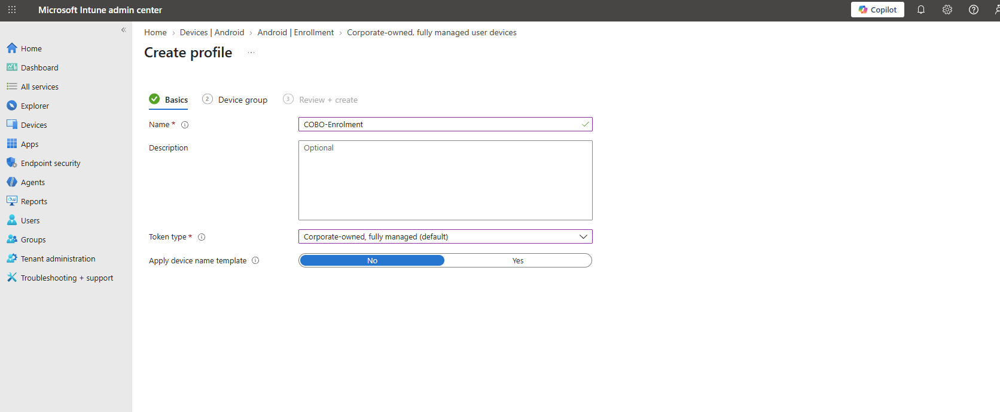
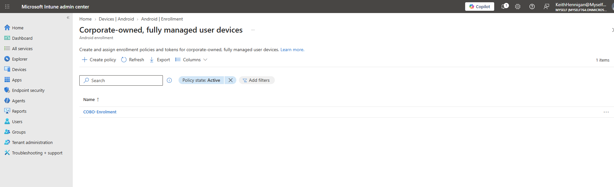
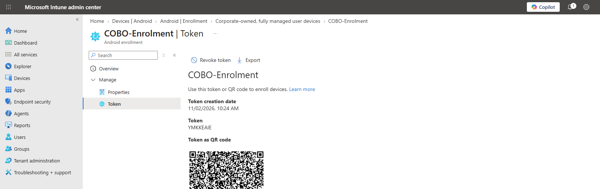
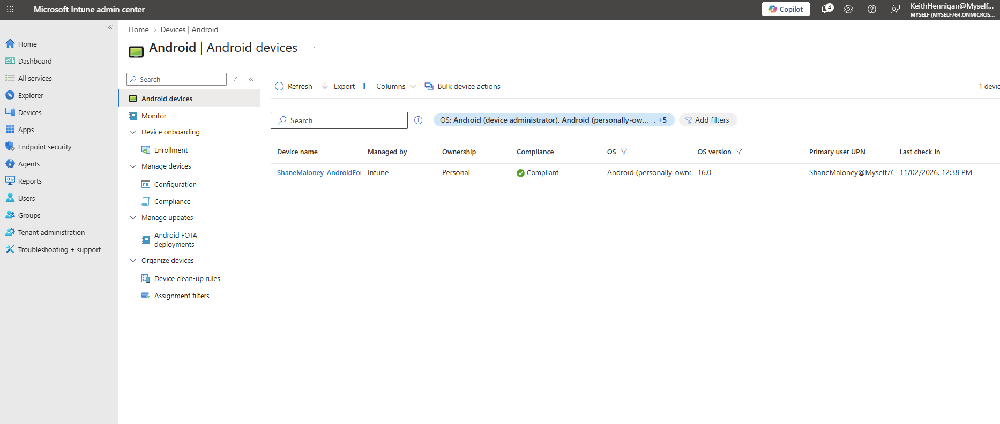

<h1>Microsoft Intune Android Enterprise Lab</h1> <h2>Description</h2> This project extends my <a href="https://github.com/kkeith5/Microsoft365EntraIdAdminLab">Microsoft 365 / Entra ID Admin Lab</a> into device management with Microsoft Intune. I set up Android Enterprise in Intune, created compliance policies for both corporate fully managed and personally owned (work profile) devices, deployed Microsoft Authenticator as a required app, created a fully managed enrolment profile and token, and enrolled a real Android phone as a test user, which shows as compliant in Intune.   <h2>Why I built this</h2> I built this to get hands-on with the kind of work involved in a corporate mobile device rollout: enrolling Android devices into Intune, making sure they meet company security standards, and getting users signed in with Microsoft Entra ID and Microsoft Authenticator. It builds on the same tenant, users and groups from my earlier labs, so it adds device management on top of the identity side I'd already built. <h2>Skills Demonstrated</h2>
Linking Managed Google Play to Intune for Android Enterprise
Creating Android Enterprise compliance policies for corporate fully managed (COBO) and personally owned work profile (BYOD) devices
Deploying Managed Google Play apps as Required (Microsoft Authenticator)
Creating a corporate-owned, fully managed enrolment profile and token for QR-code enrolment
Understanding the difference between default and staging tokens
Enrolling an Android device with a work profile using Intune Company Portal
Verifying device compliance and registration in Intune and Entra ID
Group-based targeting of policies and apps, keeping admin accounts separate from user device groups
<h2>Utilities Used</h2>
<b>Microsoft Intune admin center</b>
<b>Microsoft Entra admin center</b>
<b>Managed Google Play</b>
<b>Intune Company Portal (Android)</b>
<b>Microsoft Authenticator</b>
<h2>Environments Used</h2>
<b>Microsoft Entra ID / Intune</b> tenant (Myself764.onmicrosoft.com, Intune trial)
<b>Android 16</b> phone, enrolled as a personally owned work profile device
<h2>Lab walk-through:</h2> 
 <h3>1. Created a security group for the rollout:</h3> Created an assigned security group (SG-Mobile-Rollout) for the test users. All the compliance policies and apps are assigned to this group rather than to individual users. My admin account isn't in it, only the test users.     <h3>2. Licence assigned to the group:</h3> Assigned the licence that includes Intune to the group, so every member gets it automatically instead of licensing users one by one. Users need a licence with Intune before they can enrol a device.     <h3>3. Managed Google Play linked to Intune:</h3> This connects Intune to Google so it can manage Android Enterprise devices and deploy apps from Managed Google Play.     <h3>4. Compliance policies:</h3> Created two Android Enterprise compliance policies: COBO-Compliance for corporate fully managed devices, and BYOD-Compliance for personally owned work profile devices. Each policy only applies to its own enrolment type, so both can be assigned to the same group without clashing.     <h3>5. Compliance policy settings:</h3> Blocks rooted devices, checks Play Integrity, requires a numeric complex PIN (minimum 6 digits), locks after 5 minutes of inactivity, requires encryption and a minimum OS version of Android 13. Devices that don't meet it are marked non-compliant immediately.     <h3>6. Apps from Managed Google Play, with Authenticator assigned as Required:</h3> Intune automatically added Company Portal, Microsoft Intune, Managed Home Screen and Microsoft Authenticator when Managed Google Play was linked. I assigned Authenticator as Required so it installs automatically into the work profile.     <h3>7. Android enrolment options:</h3> Turned on enrolment for corporate-owned, fully managed user devices, and checked personally owned work profile enrolment was allowed for testing on my own phone.     <h3>8. Fully managed enrolment profile created:</h3>     <h3>9. Enrolment token and QR code:</h3> This generates the QR code a technician scans on a factory-reset phone (tap the welcome screen six times, scan the code). Token and QR code blurred, and the token revoked after testing.     <h3>10. Test user's phone enrolled and Compliant in Intune:</h3> Signed in to Intune Company Portal on my phone as a test user, which created a separate work profile. The device shows in Intune as a personally owned work profile device on Android 16, marked Compliant.     <!-- Add this section once the passkey test is done: <h3>11. Passkey registered in Microsoft Authenticator and passwordless sign-in tested:</h3> Enabled Temporary Access Pass and Passkey (FIDO2) in Entra ID authentication methods, registered a passkey in the work profile's Authenticator, then signed in to office.com with no password.     --> 
 <h2>Enrolment types: what I learned</h2>
Enrolment type	Who owns it	What IT controls	Typical use
Personally owned work profile (BYOD)	Employee	Work profile only	Staff using their own phone for work email/apps
Corporate-owned work profile	Company	Work profile, plus some device settings	Company phone where personal use is allowed
Corporate-owned, fully managed (COBO)	Company	Whole device	Company phone for work use only
Corporate-owned dedicated	Company	Whole device, locked to set apps	Kiosks, scanners, shared devices

Fully managed enrolment methods:

QR code: a technician factory-resets the phone, taps the welcome screen six times and scans the code from the enrolment profile. Manual, one device at a time. This is the method I set up.
Zero-touch (Google) / Knox Mobile Enrollment (Samsung): the reseller registers the devices before they arrive, and they enrol automatically on first boot once connected to Wi-Fi. Used for large rollouts. These need devices registered by a reseller, so I couldn't test them in a home lab.
Default vs staging token: a default token is for a user to enrol and sign in straight away. A staging token lets IT (or a reseller) prepare the device first, and the user signs in later.
<h2>Troubleshooting and Lessons Learned</h2>

Issue: my lab tenant didn't include Intune My tenant originally had an Office 365 E5 licence, which doesn't include Intune. I had to get a trial with an Intune licence on the same tenant before I could start. I turned off recurring billing straight away, since a previous trial had converted to paid.

Issue: new security group didn't show up when assigning the compliance policy My older groups appeared in the assignment picker but the new one didn't. New groups can take a while to show up in Intune, so I created the policy first and came back to the assignment later.

Issue: Managed Google Play "Select" didn't load When adding apps through Managed Google Play, clicking Select didn't open the Google Play window. The likely cause is the browser blocking the embedded Google content (third-party cookies or privacy settings). Authenticator, the app that mattered for this lab, had already been added automatically, so I assigned that and moved on. Outlook and Teams are still to add.

Issue: no option to set a token expiry date The expiry date field didn't appear when creating the enrolment profile. Either way, the important step is revoking the token once you're finished, so the QR code can't be used to enrol other devices.

Main things I picked up:

A compliance policy is a checklist, not a set of changes. It marks the device compliant or non-compliant. It's Conditional Access (not set up in this lab) that would actually block email or Teams on a non-compliant device.
With work profile enrolment, the user installs Company Portal themselves. With fully managed, scanning the QR code tells the phone to download the Intune app and Authenticator on its own.
Managed Google Play apps install silently onto Android Enterprise devices. The older "Android store app" type only gives the user a link to the Play Store.
Use test users for device enrolment, not admin accounts, and keep admins out of user device groups.
On a corporate network, firewalls need to allow Intune's network endpoints, otherwise devices fail to enrol or check in.
